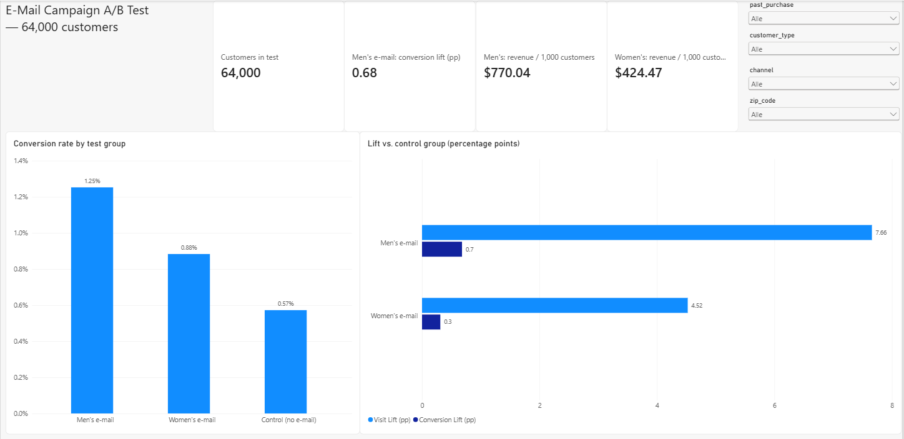
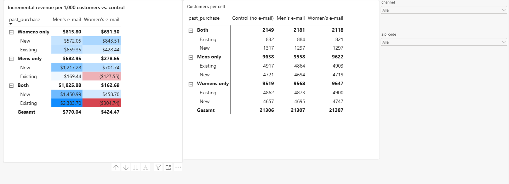

# Does a promotional e-mail actually drive sales? An A/B test analysis

Analysis of a randomized e-mail marketing experiment with **64,000 customers** and three arms: men's campaign, women's campaign and a no-email control group. The goal is to measure the **incremental** effect of each campaign on visits, conversions and spend, and to recommend **who should receive which e-mail**.

**Recommendation:** send the **men's e-mail to all customers** (about **+$221 profit per 1,000 customers** vs. no e-mail). Segment-based targeting did not add measurable value. 📄 [One-page memo](reports/memo.pdf)

---

## Key results

- **Experiment health:** group sizes match the planned 1/3 split (SRM p = 0.90) and all pre-treatment covariates are balanced (max |SMD| = 0.014).
- **Men's e-mail:** visit rate **10.6% → 18.3%** (+7.7 pp, 95% CI [7.0, 8.3]); conversion **0.57% → 1.25%**; **+$0.77 spend per customer** (bootstrap CI [0.48, 1.05]).
- **Women's e-mail:** visit +4.5 pp, conversion +0.31 pp, +$0.42 spend per customer. Significant, but clearly weaker.
- **Segments:** the men's e-mail lifted spend in every segment; the women's e-mail had no clear effect for men-only buyers, existing customers and phone customers.
- **Targeting:** a rule learned from the data looked better in-sample (+$19 per 1,000) but **lost $27 per 1,000 on held-out data** (better in only 26% of 200 splits): overfitting. "Match past purchase" was indistinguishable from men's-to-all (+$3, CI [−51, +61]).
- **Robustness:** sending breaks even up to ~$0.23 per e-mail (30% margin); CUPED and covariate adjustment left estimates unchanged (past spend explains < 0.5% of outcome variance).

## Power BI dashboard

An interactive dashboard of the same results: KPI cards, conversion by test group, incremental lift vs. control, and a segment-level lift matrix with slicers. Every figure was cross-checked against the Python analysis ([reference values](powerbi/reference_values_from_python.csv)).




Files: [`email_ab_test_dashboard.pbix`](powerbi/email_ab_test_dashboard.pbix) · [DAX measures](powerbi/measures.dax)
---

## The experiment

| | |
|---|---|
| Data | [Kevin Hillstrom MineThatData E-Mail Analytics Challenge (2008)](https://blog.minethatdata.com/2008/03/minethatdata-e-mail-analytics-and-data.html) |
| Population | 64,000 customers who purchased in the previous 12 months |
| Arms | `Mens E-Mail` · `Womens E-Mail` · `No E-Mail` (control), randomized ~1/3 each |
| Outcomes (2 weeks) | `visit`, `conversion`, `spend` |
| Pre-treatment covariates | recency, past-year spend (`history`), bought men's/women's, new customer, zip-code type, channel |

## Approach

1. **Data-quality checks in SQL**: missing values, logical consistency (no conversion without a visit, etc.), group profiles. See [`sql/01_data_checks.sql`](sql/01_data_checks.sql).
2. **Experiment health**: sample ratio mismatch (chi-square) and covariate balance (standardized mean differences).
3. **Main effects**: absolute and relative lift with 95% CIs; Holm correction for multiple comparisons; bootstrap CIs for the heavy-tailed spend metric.
4. **Variance reduction (CUPED)**: past-year spend as the pre-period covariate, to tighten the confidence intervals.
5. **Power and MDE**: which effects this sample can and cannot detect, and the sample size a follow-up test would need.
6. **Heterogeneous effects**: which customer segments respond to which campaign.
7. **Business recommendation**: inverse-probability-weighted evaluation of sending rules, honest train/test validation of a learned rule, break-even and sensitivity analysis, summarized in a one-page memo.

## Repository structure

```
├── notebooks/
│   ├── 01_data_checks_and_main_effects.ipynb   ✅
│   ├── 02_cuped_power_segments.ipynb           ✅
│   └── 03_targeting_recommendation.ipynb       ✅
├── sql/
│   └── 01_data_checks.sql        # data-quality and experiment-health queries
├── src/
│   ├── data.py                   # download, schema validation, SQLite loading
│   ├── stats_utils.py            # SRM, balance, lift CIs, bootstrap, Holm, CUPED, power
│   └── policy.py                 # IPW evaluation of targeting rules
├── reports/
│   └── memo.pdf                  # one-page summary for stakeholders  ✅
├── data/                         # raw CSV (downloaded automatically, not committed)
└── requirements.txt
```

## How to run

```bash
pip install -r requirements.txt
jupyter notebook notebooks/01_data_checks_and_main_effects.ipynb
```

The first run downloads the data into `data/`. If the download fails, see [`data/README.md`](data/README.md).

## Tools

Python (pandas, NumPy, SciPy, matplotlib) · SQL (SQLite) · Jupyter
